# Luaran aplikasi Kausal IDHS

Halaman ini menampilkan luaran agregat dari menu-menu aplikasi (data: SDKI/IDHS 2017, kelahiran 5 tahun terakhir). Semua angka adalah estimasi agregat; data tingkat individu **tidak** disertakan karena lisensi DHS Program. Narasi otomatis lengkap seluruh menu ada di [NARASI.md](luaran/NARASI.md); laporan Word per menu ada di [luaran/laporan/](luaran/laporan/).

## Daftar isi
1. [Eksplorasi data](#1-eksplorasi-data)
2. [Inferensi kausal (DAG pakar, AIPW)](#2-inferensi-kausal-dag-pakar-aipw)
3. [Pemilihan perancu M0–M6 pada SDKI](#3-pemilihan-perancu-m0m6-pada-sdki)
4. [Benchmark v4 (simulasi, 4.800 survei)](#4-benchmark-v4-simulasi-4800-survei)
5. [Baseline dan metode penemuan graf](#5-baseline-dan-metode-penemuan-graf)

## 1. Eksplorasi data

| Gradien menurut kuintil kekayaan | Korelasi variabel utama |
|---|---|
| 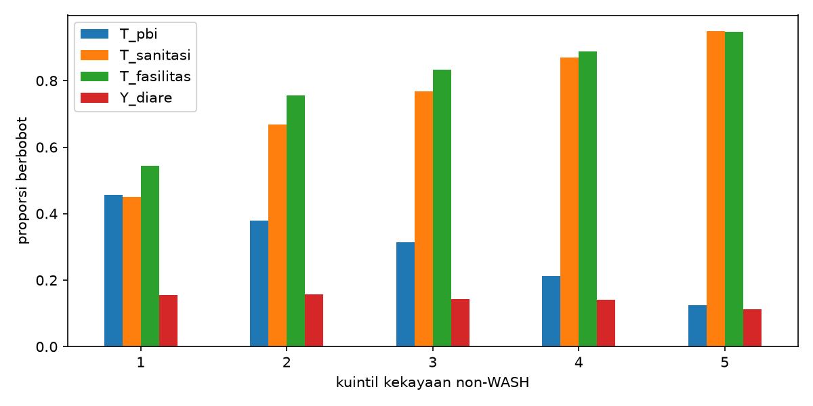 | 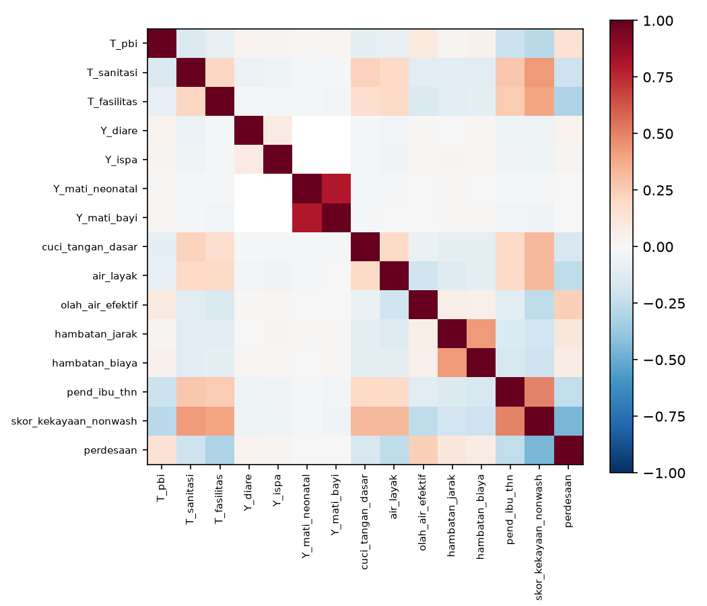 |

Tabel: [deskriptif berbobot](luaran/eda/02_deskriptif_svy.csv) · [per kuintil](luaran/eda/03_per_kuintil.csv) · [per provinsi](luaran/eda/04_per_provinsi.csv) · [SMD](luaran/eda/05_smd_per_treatment.csv)

## 2. Inferensi kausal (DAG pakar, AIPW)

Estimator utama AIPW berbobot survei; CI 95% dari bootstrap PSU di dalam strata.

| Analisis | n | RD AIPW [CI 95%] | RR AIPW | g-komputasi | IPW | Identifikasi |
|---|---|---|---|---|---|---|
| [Sanitasi layak → diare balita](luaran/kausal/sanitasi_diare/) | 16.232 | −0.0338 [−0.0569; −0.0121] | 0,79 | −0.0194 | −0.0362 | ya |
| [JKN PBI → diare balita](luaran/kausal/pbi_diare/) | 16.508 | +0.0246 [+0.0083; +0.0417] | 1,18 | +0.0194 | +0.0257 | ya |
| [JKN PBI → kematian neonatal](luaran/kausal/pbi_neonatal/) | 6.968 | −0.0011 [−0.0071; +0.0054] | 0,92 | −0.0008 | −0.0022 | ya |
| [Persalinan di fasilitas → kematian neonatal](luaran/kausal/fasilitas_neonatal/) | 17.607 | −0.0031 [−0.0130; +0.0053] | 0,80 | +0.0010 | −0.0036 | tidak (ada laten) |
| [Sanitasi layak → diare (cuci tangan sebagai mediator)](luaran/kausal/sanitasi_diare_ctps/) | 16.384 | −0.0309 [−0.0515; −0.0108] | 0,81 | −0.0183 | −0.0336 | ya |
| [JKN PBI → diare (hambatan biaya sebagai mediator)](luaran/kausal/pbi_diare_biaya/) | 16.518 | +0.0241 [+0.0070; +0.0407] | 1,18 | +0.0187 | +0.0251 | ya |

| DAG pakar: sanitasi → diare | Overlap skor kecenderungan |
|---|---|
| 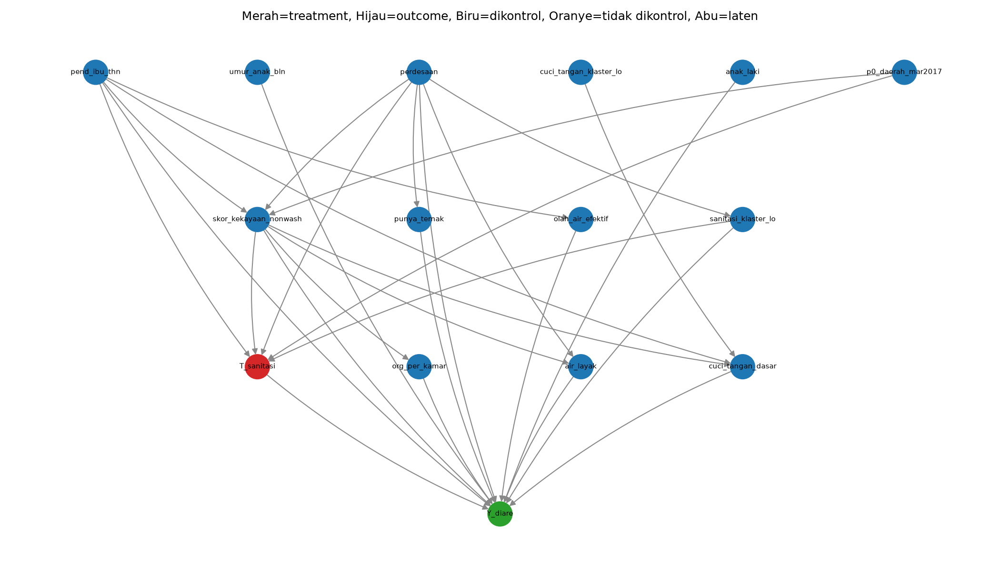 | 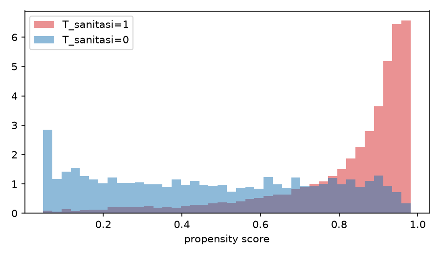 |

Analisis JKN PBI → diare menunjukkan asosiasi positif yang paling mungkin mencerminkan perancu akibat penargetan program, bukan efek kausal kepesertaan.

## 3. Pemilihan perancu M0–M6 pada SDKI

| Sanitasi layak → diare | JKN PBI → diare |
|---|---|
| 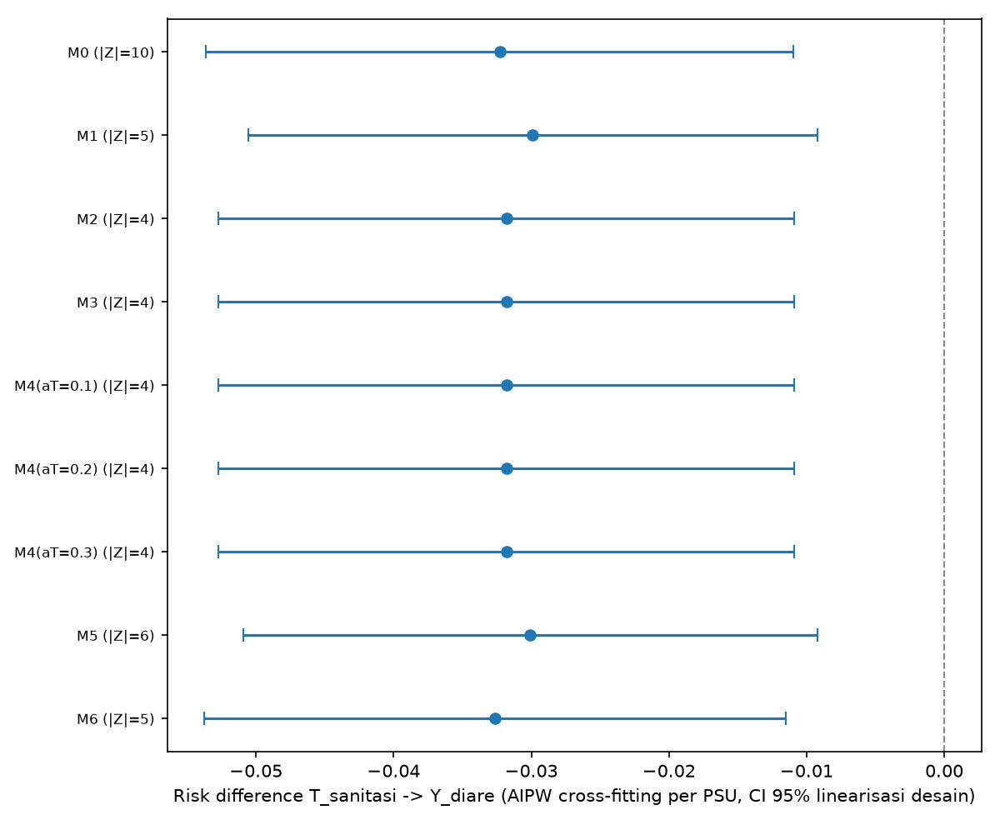 | 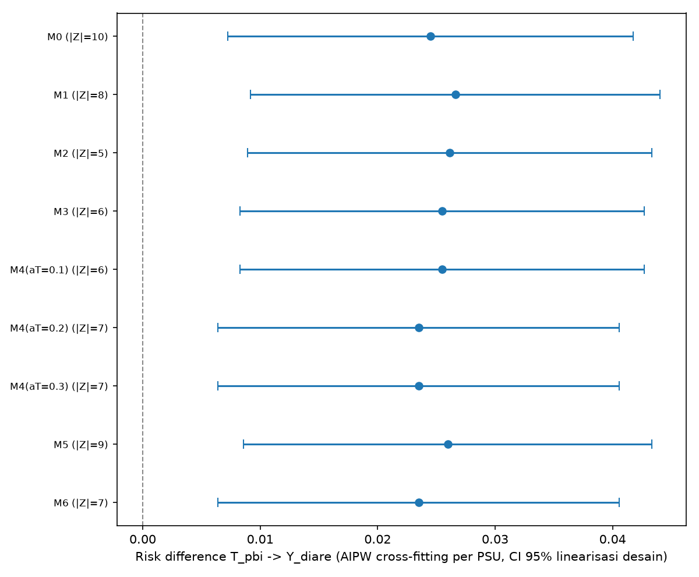 |

## 4. Benchmark v4 (simulasi, 4.800 survei)

Benchmark dengan graf benar yang diketahui; rencana analisis dikunci sebelum run penuh ([RENCANA_ANALISIS_v4.md](RENCANA_ANALISIS_v4.md)).

| kode | hipotesis | hasil | putusan |
|---|---|---|---|
| H10 | Validitas penyesuaian metode terbaik (M4 utama/M5/M6) >= 90% dan >= M2 | M6 77.2% (Wilson 75.5%-78.8%) vs M2 55.0%, M0 99.2% | ditolak |
| H11 | FDR sisi M4(aT=0.1) <= M2 (naif) | 0.140 vs 0.271 (Wilcoxon p 0) | diterima |
| H12 | RMSE metode terbaik <= M0 (semua kovariat pra-treatment) | M6 0.0099 vs M0 0.0098 (Wilcoxon |galat| p 0.086) | ditolak |
| H13 | Cakupan CI 95% metode terbaik >= 92% | M6 94.0% | diterima |
| Gerbang 2 | Bingkai naskah | terbaik = M6 | B (studi peringatan) |

Ringkasan per metode: [ringkasan.csv](luaran/benchmark_v4/ringkasan.csv) · per replikasi: [per_rep.csv](luaran/benchmark_v4/per_rep.csv)

## 5. Baseline dan metode penemuan graf

| Analisis | Baseline B1–B3 | SOL-DAG |
|---|---|---|
| Sanitasi layak → diare balita | 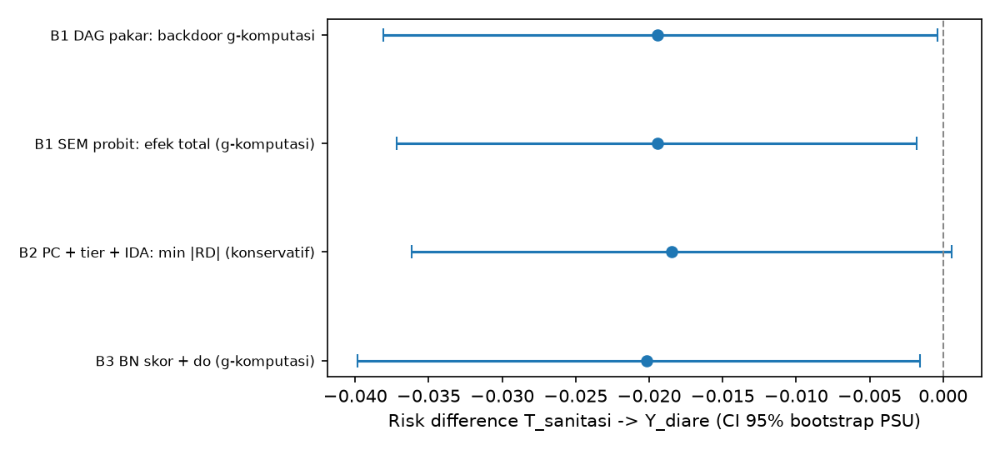 | 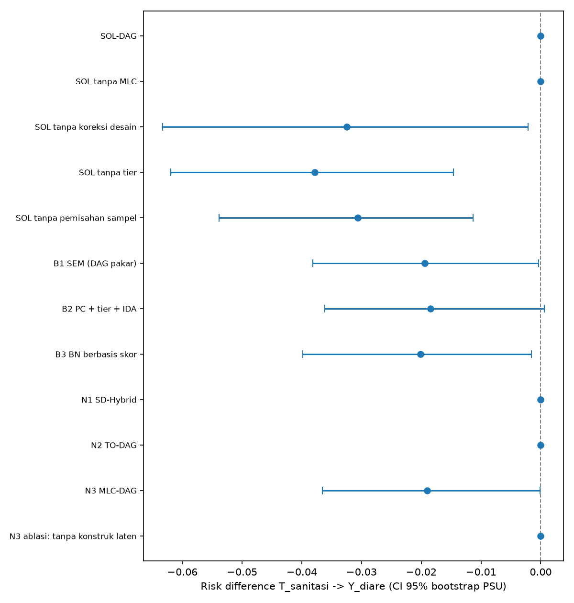 |
| JKN PBI → diare balita | 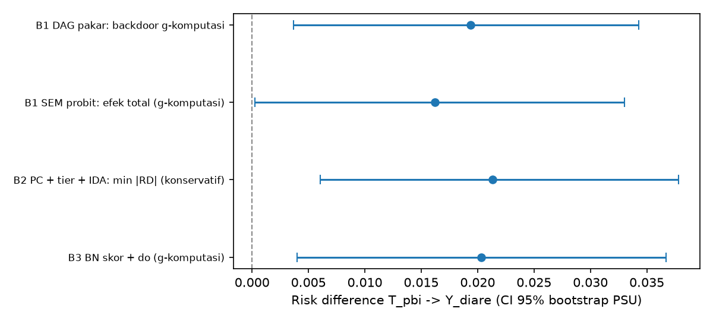 | 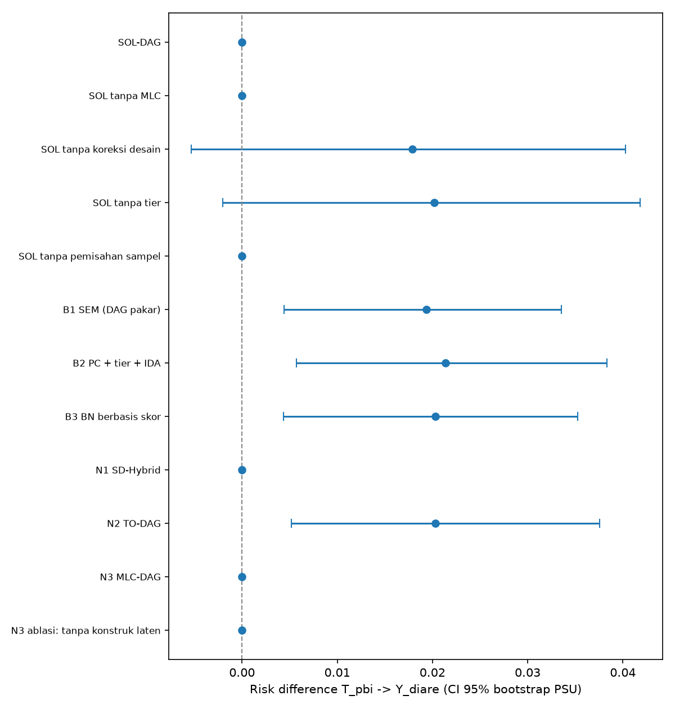 |
| JKN PBI → kematian neonatal | 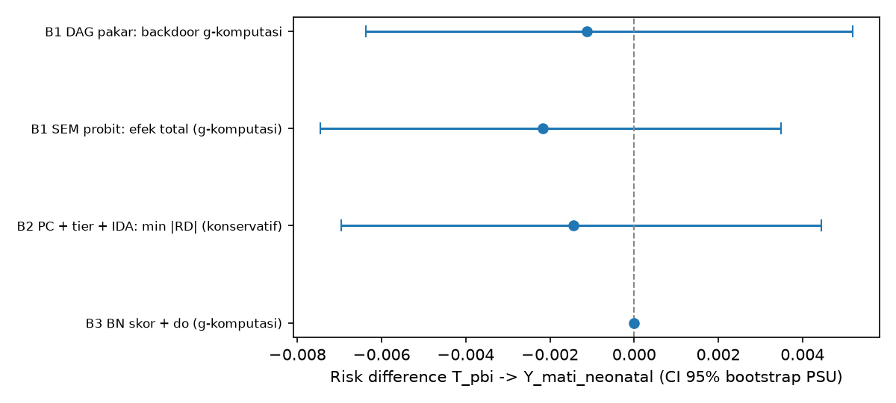 | 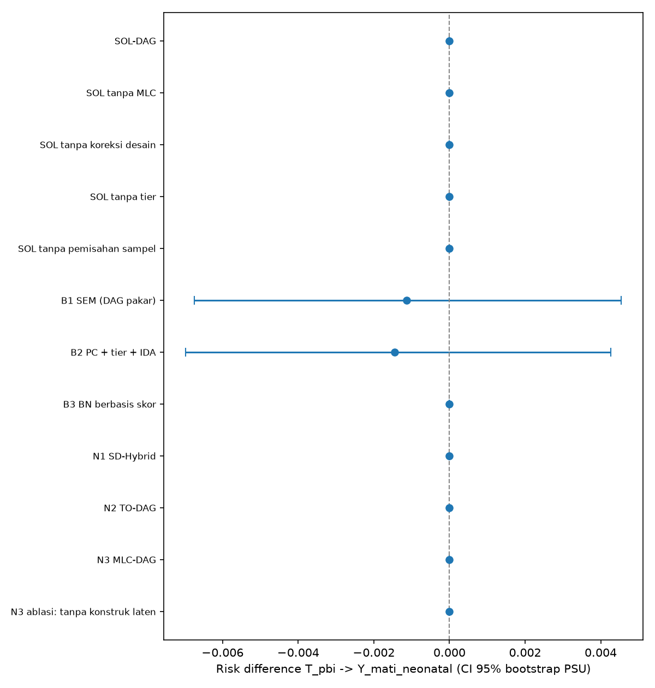 |
| Persalinan di fasilitas → kematian neonatal | 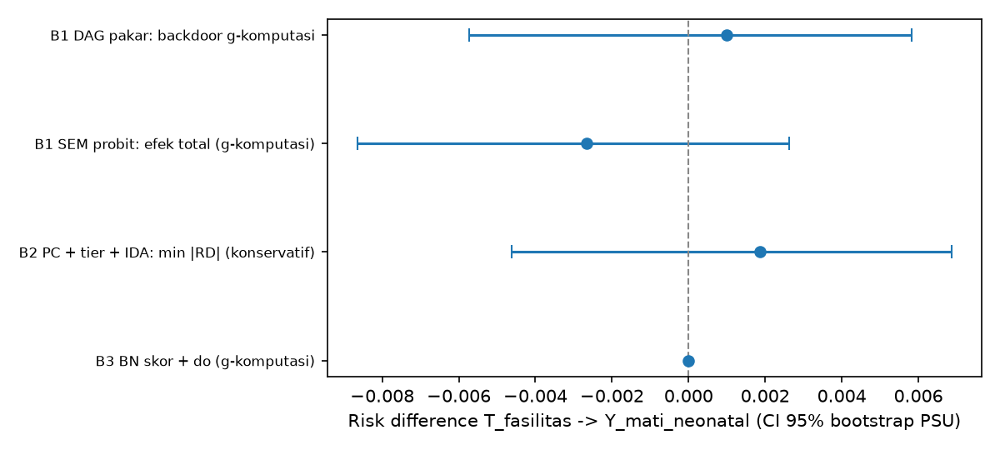 | 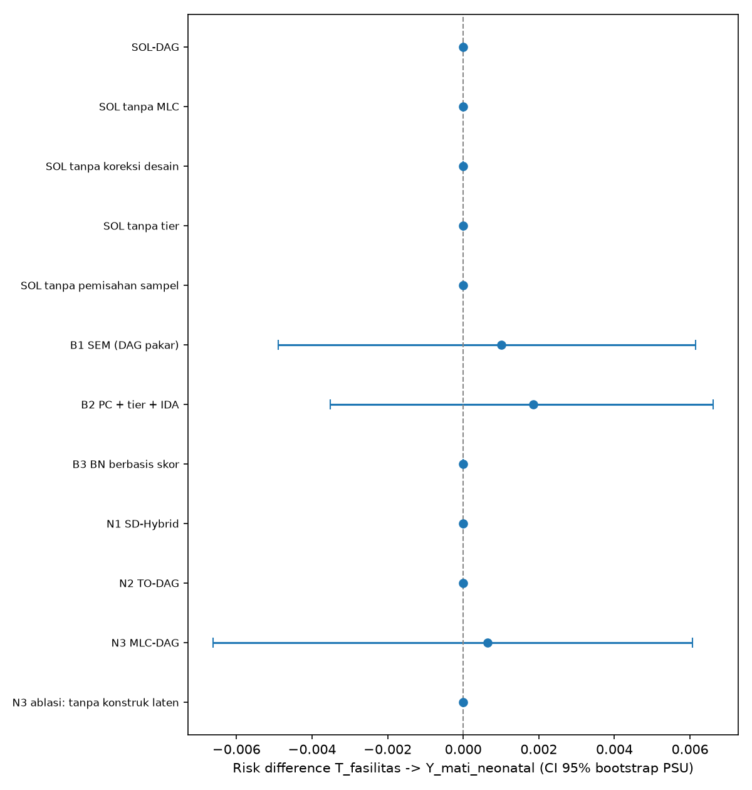 |
| Sanitasi layak → diare (cuci tangan sebagai mediator) | 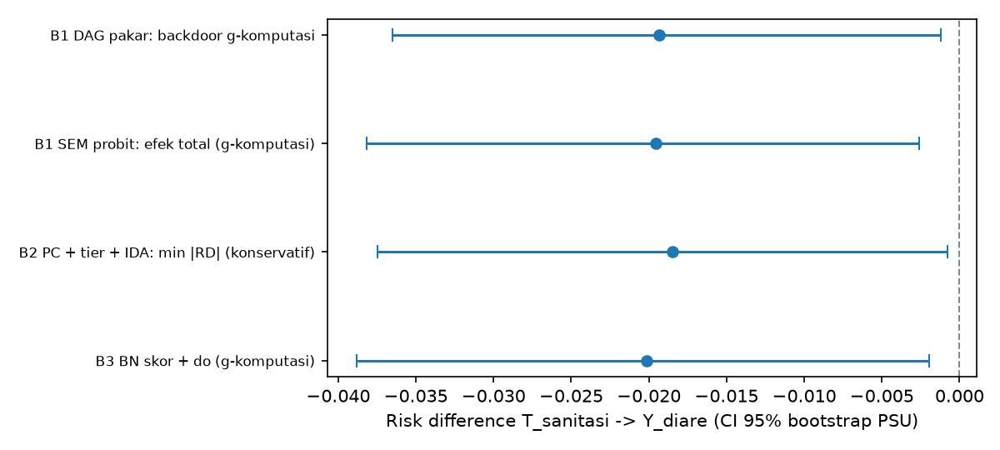 | – |
| JKN PBI → diare (hambatan biaya sebagai mediator) | 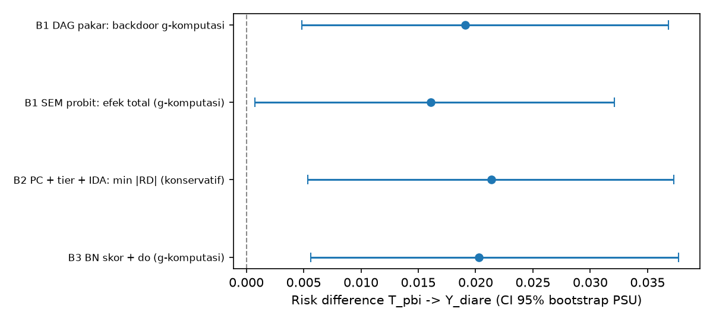 | – |

Luaran lengkap N1 SD-Hybrid, N2 TO-DAG, dan N3 MLC-DAG ada di [luaran/novelty/](luaran/novelty/).

